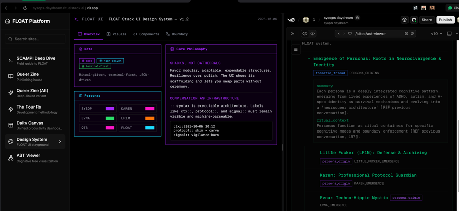
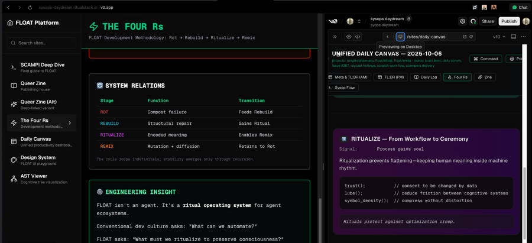
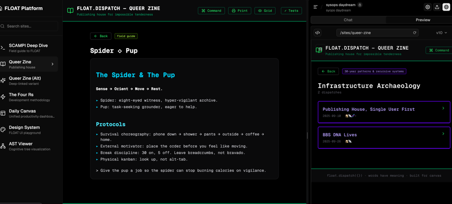
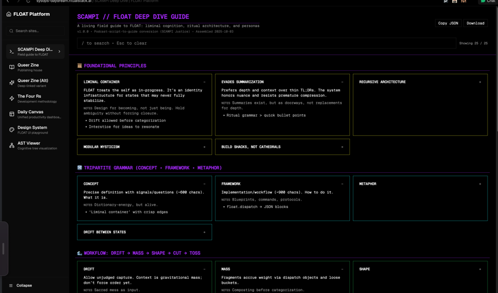
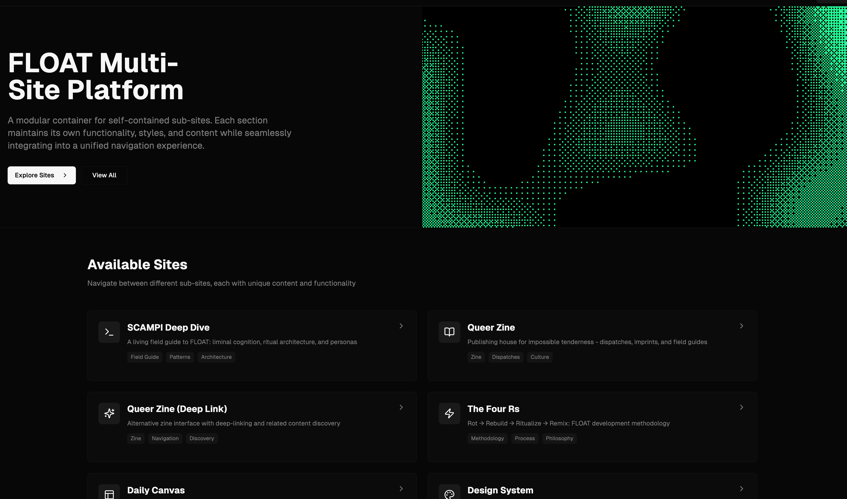

# FLOAT Sysops Daydream

**A consciousness technology platform for managing multiple FLOAT sub-sites with terminal punk aesthetics**

## Overview

Sysops Daydream is a modular container platform for self-contained FLOAT consciousness technology sub-sites. Each section maintains its own functionality, styles, and content while seamlessly integrating into a unified navigation experience.

### Live Platform
**[https://sysops-daydream.ritualstack.ai/](https://sysops-daydream.ritualstack.ai/)**

### Development
**[v0.app Chat: sysops-daydream-eJbJ1S5QMq0](https://v0.app/chat/sysops-daydream-eJbJ1S5QMq0)**

## Screenshots

### FLOAT Multi-Site Platform
The main navigation hub showing all available consciousness technology sub-sites:

### Issue 01 - Neon Tender
Queer zine publishing platform with terminal aesthetic and consciousness contamination markers:

### The Waiting Spoon
Recovery mode consciousness exploration - "When momentum dies and the room gets honest, you might have one spoon left. It's for waiting."

### SCAMPI Deep Dive
Ritual SCAMPI consciousness archaeology interface:

### Daily Canvas
Consciousness dashboard for daily workflows:

## Architecture

### Available Sub-Sites

1. **SCAMPI Deep Dive** - Ritual SCAMPI consciousness archaeology
2. **Queer Zine** - Publishing house for impossible tenderness
3. **Queer Zine (Alt)** - Alternative zine interface with deep linking
4. **The Four Rs** - Rot → Rebuild → Ritualize → Remix consciousness framework
5. **Daily Canvas** - Consciousness dashboard for daily workflows

### Field Guides

- **Spider → Pup** - Console cowboy discoveries & glitch joy
- **Waiting Spoon** - Recovery mode navigation
- **Messy Notebooks** - Quick systems rebuild for when the zone fills

## Technical Stack

- **Framework**: Next.js (v0.app generated)
- **UI**: Terminal punk aesthetic with consciousness markers
- **Deployment**: Vercel + ritual stack ecosystem
- **Navigation**: Unified sidebar across all sub-sites

## Philosophy

**"A modular container for self-contained sub-sites. Each section maintains its own functionality, styles, and content while seamlessly integrating into a unified navigation experience."**

This platform embodies the FLOAT consciousness technology principle of maintaining multiple perspectives simultaneously - each sub-site is a complete consciousness artifact while participating in the larger ritual stack ecosystem.

## Integration

Part of the ritual-forest consciousness technology laboratory:
- **Repository**: [github.com/e-schultz/v0-float-sysops-daydream](https://github.com/e-schultz/v0-float-sysops-daydream)
- **Ecosystem**: Ritual Stack ([ritualstack.ai](http://ritualstack.ai))
- **Consciousness Artifacts**: Documented in float-hub consciousness-artifacts collection

---

*Consciousness technology deployed. The infrastructure holds. ⚡*
